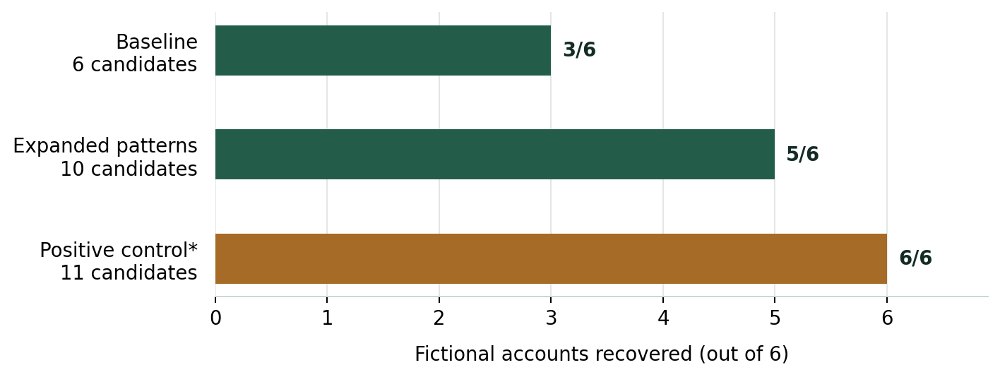

# Password Exposure & Defense

A small, reproducible offline password-auditing lab and independent security report for **Mustafa Al Azzawi**.

[Interactive case study](https://mustafa-al-azzawi-portfolio.mustafaalazzawi.chatgpt.site/security-lab.html) · [PDF report](docs/Password-Security-Report.pdf) · [Arabic interview notes](docs/INTERVIEW-NOTES-AR.md)

## What the experiment shows

Six fictional accounts were hashed with SHA-512-crypt and unique salts. Three isolated John the Ripper wordlist runs produced:

| Run | Candidates | Accounts recovered | Meaning |
| --- | ---: | ---: | --- |
| Baseline | 6 | 3 of 6 | A numeric password and a reused dictionary password were present in this list. |
| Expanded patterns | 10 | 5 of 6 | Two deliberately included predictable patterns were additionally recovered. |
| Positive control | 11 | 6 of 6 | The random plaintext was deliberately added. This validates the fixture; it is not evidence of guessing a random secret. |



**Positive control:** the known random plaintext is deliberately supplied; it is not a successful guess of an unknown random secret.

These tiny lists were constructed for the demonstration. The recovery counts are not a population crack rate, password-strength rating, time-to-crack estimate, or benchmark. A password absent from these lists is not proven secure.

## Scope

- Only generated fictional credentials; no user, classmate, employer, or website accounts.
- The runner creates its own inputs. It does not accept an external password-hash file.
- Exposure of a readable hash copy is assumed. No physical intrusion, USB exploitation, credential extraction, network login, or bypass is attempted.
- SHA-512-crypt with OpenSSL's default 5,000 rounds is a compatibility-focused teaching fixture, not a recommended password-storage deployment.
- Each run has a fresh local pot file. No previous recovery cache is used.

## Reproduce on Linux x86_64

Requirements: Python 3, OpenSSL with `passwd -6`, C compiler, make, curl, tar/xz. The audited run used John core 1.9.0 and OpenSSL 3.5.9. No third-party Python packages are needed for the lab itself.

```bash
bash scripts/setup-john.sh
python3 run_lab.py --john-dir tools/john-1.9.0/run --output evidence/my-new-run
python3 verify_evidence.py evidence/my-new-run
```

The output directory must not already exist. Each reproduction generates a new random comparison password; compare recovery counts and checks, not byte-identical hashes. Setup requires internet access; the experiment itself does not use the network.

The supplied evidence under `evidence/run-20261125/` is the actual initial run. `summary.json` records tool versions, timestamps, hashes, and 23 passing fixture/result assertions. Raw `run.txt` and `show.txt` files preserve John output. `fixtures.json`, wordlists, and pot files contain deliberately public demonstration passwords. Never use them as real credentials.

## Read the deliverables

- `docs/REPORT.md`: accessible report source.
- `docs/Password-Security-Report.pdf`: formatted report.
- `docs/INTERVIEW-NOTES-AR.md`: Arabic study and interview notes.
- `docs/PROVENANCE.md`: what was executed, what was not, and authorship context.
- `evidence/verification.json`: independent evidence-consistency check.

## Interpretation and controls

Salting makes equal passwords produce different stored hashes, but does not prevent checking guesses. Long, unique generated passwords reduce predictable choices. Suitable costly salted password hashing and restricted hash access address offline risk. Online rate limits and MFA protect different parts of authentication; they do not prevent comparing guesses against a hash copy already obtained. Disk encryption and device/media controls reduce exposure risk. These controls are discussed, not experimentally validated here.

## Sources

1. Openwall, [John command-line options](https://www.openwall.com/john/doc/OPTIONS.shtml) and [wordlist mode](https://www.openwall.com/john/doc/MODES.shtml).
2. NIST, [SP 800-63B-4, Password Verifiers and Appendix A](https://pages.nist.gov/800-63-4/sp800-63b.html).
3. Apple, [Volume encryption with FileVault](https://support.apple.com/guide/security/volume-encryption-with-filevault-sec4c6dc1b6e/1/web/1).
4. CISA, [The Risks of Using Portable Devices](https://www.cisa.gov/sites/default/files/publications/RisksOfPortableDevices.pdf).

Documentation checked 25 November 2026. The report is educational and does not claim NIST certification or assessment of a real organization.

## Regenerate the PDF

The prebuilt PDF is included. To rebuild it on Linux, install Python packages `reportlab` and `matplotlib`, with DejaVu Sans fonts available under `/usr/share/fonts/truetype/dejavu`, then run `python3 scripts/build_report.py`. This reads the recorded evidence; it does not rerun John.

## Preparation

Prepared for Mustafa's portfolio with Codex assistance. The new scripts, execution evidence, analysis, and report were produced on 25 November 2026. No old presentation or undocumented historical result is represented as evidence for these new runs. Mustafa should reproduce and understand the lab before presenting the new implementation as a skill demonstration in an interview.

John remains an external dependency under its own license; its executable and source are not bundled. See its official source for license terms. The new report and supporting project currently carry no open-source license grant.
